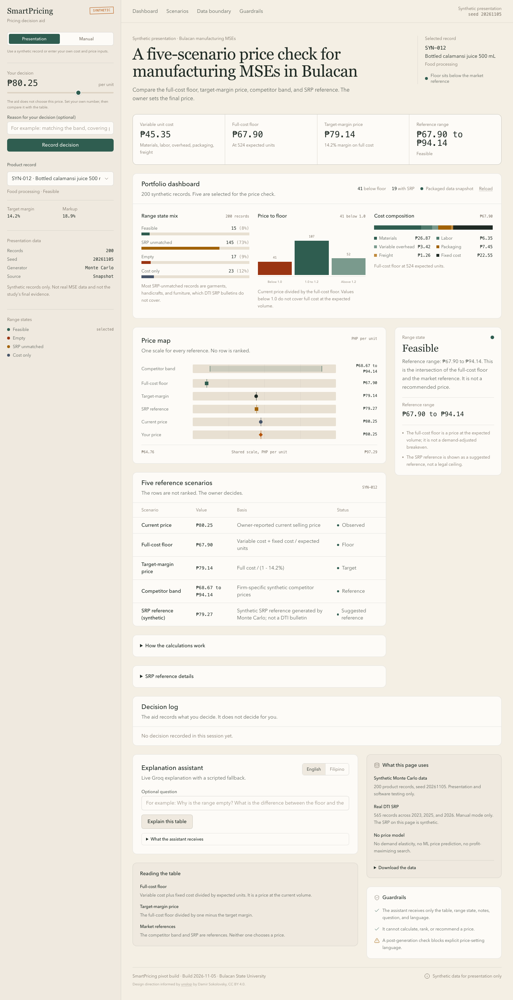

# SmartPricing

A five-scenario pricing decision aid for manufacturing and production MSEs in Bulacan.



The artifact compares a full-cost floor, target-margin price, competitor band, SRP reference, current price, and the owner's intended price on one shared scale. It does not calculate or recommend a price.

## Live site

- GitHub Pages: https://mrphilo420.github.io/smart-pricing/
- Netlify: import this repository, or drag the `docs/` folder into Netlify

## What is in the artifact

- 200 synthetic Monte Carlo product records
- Portfolio dashboard with range-state mix, price-to-floor distribution, and cost composition
- Five reference scenarios for the selected product
- Four range states: feasible, empty, SRP unmatched, and cost only
- English and Filipino explanation preview
- Session decision log
- Clear synthetic-data labels

The deployed site uses `docs/portfolio.json` as a packaged data snapshot and shows **Packaged data snapshot**. When the artifact runs on localhost with the Streamlit app available, it fetches live data from `http://localhost:8501/app/static/portfolio.json` and shows **Live from Streamlit**.

## Repository layout

```
docs/                  Static site published by GitHub Pages and Netlify
  index.html           Single-file React artifact
  portfolio.json       200-record synthetic data snapshot
  preview.png          Screenshot used in this README
source/                React and Vite source
  src/
  public/portfolio.json
netlify.toml           Netlify publish configuration
```

## Run the source locally

```bash
cd source
npm install
npm run dev
```

Open the local Vite URL. The dev build uses `source/public/portfolio.json` and can also fetch the Streamlit endpoint when it is running.

## Build

```bash
cd source
npm run build
```

The deployable `docs/index.html` is a single-file bundle. It was produced with the web-artifacts bundler. To rebuild it, use the bundling script from the web-artifacts skill, then copy the output to `docs/index.html`.

## Deploy

### GitHub Pages

1. Open the repository settings.
2. Go to **Pages**.
3. Set **Source** to **Deploy from a branch**.
4. Choose branch `main` and folder `/docs`.
5. Save.

### Netlify

Import the repository. `netlify.toml` publishes `docs` with no build step. For a manual deploy, drag the `docs/` folder into Netlify.

## Data note

The records are synthetic Monte Carlo data for presentation and software testing only. They are not real MSE data and are not the study's final evidence. The SRP value shown in the artifact is synthetic and is not a DTI bulletin.

## Credits

- Design direction informed by [unslop](https://github.com/heydamir/unslop) by Damir Sokolovsky, CC BY 4.0
- Copy review informed by no-ai-slop by Peter Yang, MIT
- Built with React, Vite, and Tailwind CSS
